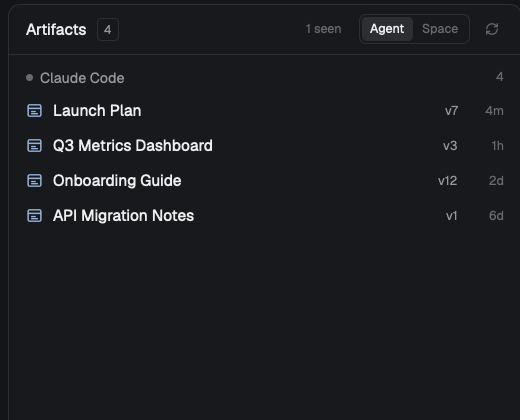

# Artifacts panel for Herdr



A [Herdr](https://herdr.dev) mod: a panel beside Files and Changes that lists
every [claude.ai artifact](https://claude.ai) the selected Claude Code agent's
conversation made or pointed you to. Switch it to **Space** to see every agent
in the space, grouped by conversation.

Each artifact is one of three levels:
- **published** (`v3`): this conversation made or updated it, or a subagent or
  child agent it started did (`via …`). `earlier` means it was made before the
  transcript was compacted.
- **linked**: the agent gave you a link to it in a reply. Shown by default.
- **seen**: the agent only read or opened it. Behind the `N seen` toggle,
  which is remembered.

Each row shows when the artifact was last updated and created on claude.ai
and how many versions it has. Sort by **Updated** (default, newest first),
**Created**, **Activity** (when this conversation last published, linked or
read it) or **Name**; clicking the active sort again reverses it, and the
choice is remembered. Click a row to open it; hover for a copy button. A collapsed **Links** section
lists every other web link the agent wrote in its replies (pull requests, docs,
dashboards). A search box covers whatever the view shows; Enter opens the top
result, arrows move, Esc clears. `artifacts.search` focuses it and, pressed
again, flips Agent and Space.

Herdr here is the desktop app (herdr-app on herdr-core), not the TUI.

## Install

```sh
git clone https://github.com/jmoyers/herdr-artifacts
cp -R herdr-artifacts/artifacts ~/.config/herdr-app/mods/artifacts
python3 ~/.config/herdr-app/mods/artifacts/install.py   # Claude Code hooks, every profile
```

Herdr's own layout and tab bar are read-only and replaced on every start,
and a mod can't add itself to them, so the panel needs a layout of your own
(clone `main`) and a tab bar with an Artifacts button (clone `tabs`):

```sh
herdr-app do layout.clone '{"name":"main","as":"main-artifacts"}'
herdr-app do mod.clone '{"name":"tabs","as":"tabs-artifacts"}'
```

In `layouts/main-artifacts.json`, set the `tabs` block's content to
`{"mod": "tabs-artifacts"}` and append
`{"id": "artifacts", "type": "block", "content": {"mod": "artifacts"}}` to the
`panel-body` stack's children. Apply `patches/tabs.diff` to
`mods/tabs-artifacts/main.js`. Keys, in `keys.json` under `global`:
`"cmd-shift-a": "tabs-artifacts.artifacts"` and
`"cmd-shift-f": "tabs-artifacts.artifacts-search"`.

Clones never follow Herdr updates. After an update, compare
`cloned_from.version` in the two clones with `herdr-app --version` and redo
the clones if Herdr's `main` or `tabs` changed.

`install.py --check` shows where the hooks are; `install.py --remove` takes
them out. New Claude Code sessions pick them up; running ones still show,
through their transcripts.

## How it works

`artifacts.py` builds one picture per conversation from every source it can
find, each filling what the others miss:

| Source | Gives |
|---|---|
| Hook `SessionStart` record (`~/.local/state/herdr-artifacts/terminals/<t>.json`) | terminal → session, transcript, profile; follows `/clear` and `/resume` |
| The Claude process in the terminal and `<profile>/sessions/<pid>.json` | terminal → session for sessions started before the hook |
| Session transcript | every Artifact call and result, the agent's replies (linked), compaction summaries (earlier) |
| Subagent transcripts (`<session>/subagents/*.jsonl`) | artifacts a native subagent published |
| Hook `PostToolUse` events (`…/events/<session>.jsonl`) | structured Artifact calls, including any the transcript lacks or words differently |
| Child terminals (`hc run` from the agent, e.g. hsub) | their publishes, under the parent, `via` the child |
| Publish input, Claude desktop app records, the page's `<title>`, comment monitor, Artifact `list` results, the agent's link text, a registry of every title seen in any session | the best title, even for a bare URL |

**Dates.** claude.ai has no API a mod can call, and the Artifact tool's `list`
gives only the day of the last update. So `artifacts.py` keeps an index of
every artifact's dates across all transcripts on the machine
(`~/.cache/herdr-artifacts/dates.json`): a publish result's version id starts
with the exact publish time and "Version 1" is the creation; a read's version
id is the version current then; a `list` row gives the updated day. Each file
is parsed once and then only its new lines (about 1.5 s to build from 1.4 GB,
0.1 s per refresh after). A created date marked `~` is the earliest version on
record, not Version 1. Archived transcripts from other machines can be added,
one folder per line, in `~/.config/herdr-artifacts/sources.txt`; lines in
other JSON formats are searched for the self-describing result text.

Profiles: `~/.claude`, `$CLAUDE_CONFIG_DIR` and every `~/.claude-<name>` (one
per account). Results are cached by the size and mtime of every input under
`~/.cache/herdr-artifacts`.

`main.js` rescans when a file feeding a shown session changes (`watchFolder`
on each profile's `projects` folder and the hook state folder), when an agent's
status changes, and every 15 s as a fallback. Apart from the two clones it uses
only documented Herdr surfaces, and its own icons.

Mod commands for `keys.json` (`"<key>": "artifacts.<command>"`): `refresh`,
`toggle-scope`, `toggle-links`, `toggle-seen`, `search`, `open-latest`, `cycle-sort`, `reverse-sort`.

## Limits

- A brand-new session shows nothing until its first message or hook record.
- Only sessions whose Claude process runs in a Herdr terminal on this machine
  are found. Sessions in other apps, or on a remote Herdr machine, are not.
- The transcript and the desktop app's records are Claude Code internals; if a
  release changes them, the hook records still carry publishes.

## Credits

`patches/tabs.diff` modifies Herdr's shipped `tabs` mod, and `chevron-*.svg`
and `spinner.svg` are copied from Herdr's shipped mods, all part of
[herdrdev/herdr-app](https://github.com/herdrdev/herdr-app) (Apache-2.0).
Everything else here is MIT.

## License

MIT
