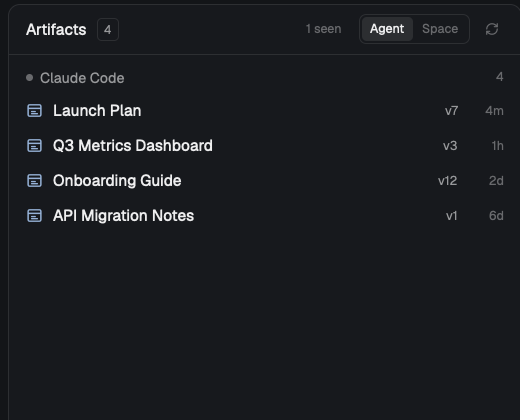

# Artifacts panel for Herdr



A [Herdr](https://herdr.dev) mod: a panel beside Files and Changes that lists
every [claude.ai artifact](https://claude.ai) the selected Claude Code agent's
conversation has published. Switch it to **Space** to see every agent in the
space, grouped by conversation.

Each row is an artifact: title, version, when it was last published. Click
it for the URL, the local source file, the publish history, and **Open** and
**Copy link** buttons. A "seen" toggle adds artifacts the session only read
or opened. A collapsed **Links** section lists every other web link the
agent wrote in its replies (pull requests, docs, dashboards), newest first;
click one to open it, or its copy icon to copy it. In Space view all
artifacts come first, grouped by tab, then all links, grouped by tab. The panel rescans
every few seconds and the moment an agent's status changes, which is when a
turn ends and artifacts appear.

Herdr here is the desktop app (herdr-app on herdr-core). It is not a
Herdr TUI plugin.

## Install

1. Get the mod into Herdr's mods folder:

   ```sh
   git clone https://github.com/jmoyers/herdr-artifacts
   cp -R herdr-artifacts/artifacts ~/.config/herdr-app/mods/artifacts
   ```

   Or ask your agent: the `RECIPE.md` in this repo is a brief it can build
   from, and `patches/` has the exact layout and tab-bar changes.
2. Herdr's own layout and tab bar are read-only, so clone them and seat the panel:

   ```sh
   herdr-app do layout.clone '{"name":"main","as":"main-artifacts"}'
   herdr-app do mod.clone '{"name":"tabs","as":"tabs-artifacts"}'
   ```

   In `layouts/main-artifacts.json`, set the `tabs` block's content to
   `{"mod": "tabs-artifacts"}` and append
   `{"id": "artifacts", "type": "block", "content": {"mod": "artifacts"}}`
   to the `panel-body` stack's children. Apply `patches/tabs.diff` to
   `mods/tabs-artifacts/main.js`: an Artifacts button next to Files and
   Changes, and a `tabs-artifacts.artifacts` command that toggles the panel.
3. Optional key, in `keys.json` under `global`:
   `"cmd-shift-a": "tabs-artifacts.artifacts"`.

The clones are yours and don't follow Herdr updates; `layout.reset` and the
shipped `tabs` mod stay untouched.

## How it works

`artifacts.py` maps each herdr-core terminal to its Claude Code session with
no hook: `hc get <t>` names the foreground process, and Claude Code writes
`~/.claude/sessions/<pid>.json` with the session id. The session transcript
at `~/.claude/projects/<cwd>/<session>.jsonl` holds every Artifact tool call
with its result ("Published … at <url> (Version N …)"). Parsed results are
cached by file size and mtime under `~/.cache/herdr-artifacts`, so a refresh
is one `hc get` per terminal plus a stat. `main.js` draws it with gpui-kit
and the app's theme colors.

Mod commands for `keys.json` (`"<key>": "artifacts.<command>"`): `refresh`,
`toggle-scope`, `toggle-links`, `toggle-seen`, `open-latest`.

## Limits

- A brand-new session has no transcript until its first message.
- Only sessions whose Claude process runs in a Herdr terminal (or under one)
  are found. Sessions in other apps are not.
- The command palette lists Herdr's built-in commands only; mods can't add
  entries in herdr-app 0.1.x, hence the key binding.

## Credits

`patches/tabs.diff` modifies Herdr's shipped `tabs` mod, which is part of
[herdrdev/herdr-app](https://github.com/herdrdev/herdr-app) (Apache-2.0).
Everything else here is MIT.

## License

MIT
