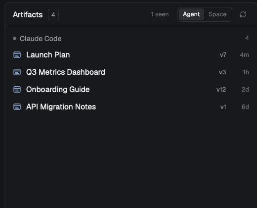

# Artifacts

A panel docked on the right that lists every claude.ai artifact the selected
Claude Code agent's conversation published or pointed you to, so the links
don't scroll away in the terminal. A switch widens it to every agent in the
space. It uses only documented Herdr surfaces: no cloned layout or tab bar.

## What you see

- The panel docks in its own column on the right (360 px, `mod.json`
  `"place": "right"`), shown and hidden with `layout.toggle:artifacts`
  (`cmd-shift-a`).
- The panel is a card: theme `background`, 1 px `border`, 10 px radius.
- Header, 42 px: "Artifacts" in semibold 13 px, a small bordered count badge
  (10 px text, `muted`), then on the right: an "N seen" toggle (only when the
  conversation read or opened artifacts it didn't publish), an **Agent /
  Space** segmented switch (10.5 px, `selected` background on the active
  side), and a refresh icon that turns while a scan runs.
- Under the header, a search box (30 px, 8 px radius, 1 px `border` that
  turns `accent` while focused, a magnifier icon, placeholder "Search
  artifacts and links", and at the right "this agent" or "whole space" when
  idle, an × to clear while searching). Typing replaces the body with
  results: a count line ("3 artifacts · 2 links · whole space · ↵ opens"),
  then 46 px two-line rows: icon (`accent` for artifacts, `muted` for links),
  title in `foreground`, and a `dim` 11 px detail line joining the tab name
  (Space mode only), the path or URL, and the description; on the right the
  tag (`v12`, "earlier", "linked", "seen", or a link's host) over the age. Every word
  of the query must match a field; artifacts rank above links, title matches
  above path, URL, description and tab matches, then newest first. Enter
  opens the selected result, up/down move, hover selects, Esc clears and
  returns focus. The box also focuses when `artifacts.search` runs or when
  shared `artifacts.focusSearch` changes, or when `pane.go` brings the
  panel the keyboard (`"focusable": true`, the `focus` command); when the
  box already has focus, `artifacts.search` flips the scope instead and keeps
  the query.
- In Space mode, a section header per agent (30 px, 8 px above all but the
  first): a chevron, a 7 px status dot in the agent's status color, the tab
  name at the rows' 13 px in medium weight and `foreground`, and a count
  pill on the right (18 px high, `raised` background, 10.5 px `muted`).
  Clicking it collapses the section; its rows are indented 20 px.
  Agent mode has no section header, just the rows.
- One row per artifact (30 px): page icon in `accent` for published, `muted`
  for linked, `dim` for seen; title in `foreground` (`muted` for seen,
  truncated); "via <child>" in 11 px `dim` when a subagent or child agent
  published it; then two right-aligned columns: the tag (46 px: `v12` in
  `muted`, or "earlier" / "linked" / "seen" in `dim`) and how long ago (30 px,
  11 px `dim`: `now`, `5m`, `3h`, `2d`, else `Nov 2`).
- Three levels: **published** (this conversation, a native subagent, or a
  child terminal it started made or updated it), **linked** (the agent wrote
  its URL in a reply you read: shown by default), **seen** (only read or
  opened: behind the "N seen" toggle, which is remembered). The header count
  is published plus linked.
- A **Links** section, closed by default: a label row (26 px, chevron,
  "Links" in 11 px medium `dim`, the count). Open, it lists one row per
  link the agent wrote in a reply (30 px): link icon in `muted`, the
  markdown link text or host and path in `foreground`, the host in `dim`
  when the title doesn't show it, the age, and the same hover-revealed copy
  button. Six links show; "N more" / "Show fewer" toggles the
  rest. Clicking a link row opens it in the browser. Artifact URLs never
  appear here.
- In Space view the body is two sections: every agent's artifacts first,
  grouped under tab headers, then one closed **Links** section above a
  1 px `border` rule, which opens into per-tab groups (28 px rows with a
  chevron, status dot and the tab name in 12.5 px medium `muted`), each
  collapsible, each with its link rows indented 28 px.
- Clicking an artifact or link row opens it in the browser. Hovering a row
  reveals a copy button in a reserved 20 px column at its right edge; clicking
  it copies the URL (without opening) and shows a check mark in the theme's
  `done` color for 1.5 s. Nothing expands in place.
- Empty states, in 11 px `dim`: no agent in the space; a session Herdr can't
  read; no transcript yet; nothing published yet.

## How it behaves

- Default scope is **Agent**: the selected agent's conversation only. If a
  plain shell is selected, it shows the space's first agent and says so.
  **Space** lists every agent in the space, grouped, the selected one first,
  then pinned ones, then by tab. The choice is remembered on this screen.
- A new selection or an agent's status change (a turn ending is when
  artifacts appear) rescans at once, as does a change to any file feeding a
  shown session (`watchFolder` on each profile's `projects` folder and the
  hook state folder, coalesced to one scan per 0.8 s); otherwise every 15 s.
- Agent status colors follow the theme's `working`, `blocked`, `done`,
  `idle`. The panel itself doesn't change an agent's status.
- Rows open in the system browser via `cx.open_url`; the copy button uses
  `cx.write_to_clipboard`.
- `artifacts.refresh`, `artifacts.toggle-scope`, `artifacts.toggle-links`,
  `artifacts.toggle-seen`, `artifacts.search` and `artifacts.open-latest` are mod commands for `keys.json`
  (`cmd-shift-f`: `artifacts.search`; `cmd-shift-a`: `layout.toggle:artifacts`).

## Built from

- `mods/artifacts/main.js`: a `View` with `init`, `refresh`, `row`,
  `button`, `scopeSwitch`, `render`. Imports `View, div, svg` from gpui-kit,
  `v_flex, h_flex` from gpui-base, and `spaces, agents, focused, exec,
  appHome, theme, nextCommand, shared, watchFolder` from herdr. Every icon is in
  the mod folder: `artifact`, `copy`, `check`, `search`, `link`, `refresh`,
  `chevron-right`, `chevron-down`, `spinner` (the last three copied from
  Herdr's shipped mods, so a Herdr rename can't break them).
- `mods/artifacts/hook.py` (standard library, silent, always exits 0),
  installed into every Claude Code profile's `settings.json` by `install.py`:
  `SessionStart` writes `~/.local/state/herdr-artifacts/terminals/<HC_TERMINAL_ID>.json`
  (session, transcript, profile, Claude pid); `PostToolUse` on
  `Artifact|ArtifactComments|ArtifactData` appends a line to
  `…/events/<session>.jsonl` (small input fields, result cut to 4 KB,
  `tool_use_id`, subagent id).
- `mods/artifacts/artifacts.py` (standard library only), run with
  `exec("python3", ["-I", "<appHome>/mods/artifacts/artifacts.py",
  "--terminals", "t1,t2"])`. Profiles: `~/.claude`, `$CLAUDE_CONFIG_DIR`, every
  `~/.claude-<name>`. For each terminal: the hook's terminal record when its
  pid is alive, checked against `hc get <t> --json` → `foreground.pid` (then
  its children, 4 deep) → `<profile>/sessions/<pid>.json` (the newer record
  wins when `/clear` changed the session) → the session's transcript, its
  `subagents/*.jsonl`, and its hook events (only calls whose `tool_use_id` the
  transcripts lack). Terminals whose `hc get` `parent` is a shown terminal
  are scanned too, and their publishes listed under the parent `via` them. It joins
  `Artifact` tool_use blocks with their tool_result by id; a result starting
  "Published … at <url>", "Updated the Artifact at <url>" or "Created a new
  Artifact at <url>" is a publish, "(Version N" its version. URLs named in
  a compaction summary count as published earlier; URLs in a main-thread
  assistant reply count as linked; reads, opens and other mentions count as
  seen. A `list` result only teaches titles. Every other `http(s)` URL in
  an assistant text block (not sidechains, not tool results) is a link, with
  the markdown link text as its title, trailing punctuation stripped,
  GitHub pull/issue URLs named `owner/repo #N`; the newest 80 are kept. Titles,
  best first: the publish's `title`, the Claude desktop app's record, an
  Artifact `list` row (the title on claude.ai now), the page's `<title>`, the
  comment monitor, a title next to the link in prose, a registry of every
  title seen in any session (`~/.cache/herdr-artifacts/titles.json`), the file
  name. Results are cached per session, keyed by the size and mtime of every
  input file. The output names the files to watch (`watch`, `watch_dirs`).

## Watch out

- `herdr-app check` renders once with no agents: never call `cx.notify()`
  on the path `render` → `refresh` takes when there is nothing to scan.
- `readTextFile` stops at 1 MiB; transcripts are bigger, so parse them in
  the Python script, not in the mod.
- A brand-new session has no transcript until its first message, and a
  compacted or teleported one has lost its publish records: only what its
  summary names is recoverable.
- Herdr docks a new mod only at app start, the first time it sees the folder
  (recorded in `seen.json`), into the layout shown then.
- The transcript, `sessions/<pid>.json` and the desktop app's records are
  Claude Code internals; the hook records are the documented path and carry
  publishes if those change.
- Version numbers come from "(Version N" with N followed by `,` or `)`;
  "version 1793114885-93b0" is a version id, not a number.
- Mod commands don't appear in the command palette (herdr-app 0.1.x), so
  the panel toggle needs a key.

## Done when

- With a Claude Code agent selected that has published, its artifacts list
  with titles, `vN` and a time; clicking a row shows its URL and path, Open
  launches the browser, Copy link puts the URL on the clipboard.
- Selecting another agent changes the list within a second.
- The Space side of the switch shows every agent in the space with its own
  section and count; collapsing a section hides its rows.
- `cmd-shift-a` shows and hides the panel; `cmd-shift-f` focuses its search box, and
  typing a word lists matching artifacts above matching links with their
  tab, path and description.
- A link the agent writes in a reply appears as "linked" within a second of
  the turn ending; an artifact published by an `hsub` child appears under the
  parent "via" the child.
- `install.py --check` shows the hook in every profile; a new session writes
  its terminal record at start.
- `herdr-app check ~/.config/herdr-app/mods/artifacts` passes and
  `herdr-app status` lists no errors.
