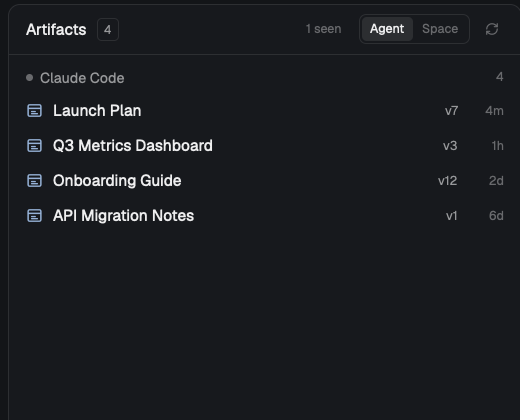

# Artifacts

A panel beside Files and Changes that lists every claude.ai artifact the
selected Claude Code agent's conversation has published, so the links don't
scroll away in the terminal. A switch widens it to every agent in the space.

## What you see

- A third button, **Artifacts**, at the right end of the tab bar next to
  Files and Changes, with a page icon. Clicking it shows the panel in the
  right-hand column (368 px wide, the same column Files and Changes use) and
  hides it again on a second click.
- The panel is a card: theme `background`, 1 px `border`, 10 px radius.
- Header, 42 px: "Artifacts" in semibold 13 px, a small bordered count badge
  (10 px text, `muted`), then on the right: an "N seen" toggle (only when the
  conversation read or opened artifacts it didn't publish), an **Agent /
  Space** segmented switch (10.5 px, `selected` background on the active
  side), and a refresh icon that turns while a scan runs.
- In Space mode, a section header per agent (30 px, 8 px above all but the
  first): a chevron, a 7 px status dot in the agent's status color, the tab
  name at the rows' 13 px in medium weight and `foreground`, and a count
  pill on the right (18 px high, `raised` background, 10.5 px `muted`).
  Clicking it collapses the section; its rows are indented 20 px.
  Agent mode has no section header, just the rows.
- One row per artifact (30 px): page icon in `accent` (`dim` for "seen"
  rows), title in `foreground` (truncated), then two right-aligned columns:
  the tag (46 px: `v12` in `muted`, or "earlier" / "seen" in `dim`) and how
  long ago (30 px, 11 px `dim`: `now`, `5m`, `3h`, `2d`, else `Nov 2`).
- Clicking a row expands it: the URL in `accent`, the source path relative to
  the conversation's folder, "N publishes · first … · last …", the publish's
  description when it had one, and two buttons: **Open** (solid) and **Copy
  link** (raised). "copied" appears for 1.5 s after copying.
- Empty states, in 11 px `dim`: no agent in the space; a session Herdr can't
  read; no transcript yet; nothing published yet.

## How it behaves

- Default scope is **Agent**: the selected agent's conversation only. If a
  plain shell is selected, it shows the space's first agent and says so.
  **Space** lists every agent in the space, grouped, the selected one first,
  then pinned ones, then by tab. The choice is remembered on this screen.
- A new selection or an agent's status change (a turn ending is when
  artifacts appear) rescans at once; otherwise every 4 s.
- Agent status colors follow the theme's `working`, `blocked`, `done`,
  `idle`. The panel itself doesn't change an agent's status.
- Rows open in the system browser via `cx.open_url`; Copy link uses
  `cx.write_to_clipboard`.
- `artifacts.refresh`, `artifacts.toggle-scope`, `artifacts.toggle-seen`
  and `artifacts.open-latest` are mod commands for `keys.json`.
  `tabs-artifacts.artifacts` toggles the panel (bound to `cmd-shift-a` in
  the recipe's install).

## Built from

- `mods/artifacts/main.js`: a `View` with `init`, `refresh`, `row`,
  `button`, `scopeSwitch`, `render`. Imports `View, div, svg` from gpui-kit,
  `v_flex, h_flex` from gpui-base, and `spaces, agents, focused, exec,
  appHome, theme, nextCommand` from herdr. Icons: `artifact.svg`,
  `open.svg`, `copy.svg`, `refresh.svg` in the mod folder, plus the shipped
  `mods/files/chevron-*.svg` and `mods/workspace-chrome/spinner.svg`.
- `mods/artifacts/artifacts.py` (standard library only), run with
  `exec("python3", ["-I", "<appHome>/mods/artifacts/artifacts.py",
  "--terminals", "t1,t2"])`. For each terminal: `hc get <t> --json` →
  `foreground.pid` (then its children, 4 deep) → `~/.claude/sessions/<pid>.json`
  → `sessionId` → `~/.claude/projects/*/<sessionId>.jsonl`. It joins
  `Artifact` tool_use blocks with their tool_result by id; a result starting
  "Published … at <url>", "Updated the Artifact at <url>" or "Created a new
  Artifact at <url>" is a publish, "(Version N" its version. URLs named in
  a compaction summary count as published earlier; URLs only in assistant
  text, and reads/opens/lists, count as seen. Titles: the publish's `title`,
  the Claude desktop app's record of the session, the page's `<title>`, the
  comment monitor's title, a title next to the link in prose, the file name.
  Results are cached per transcript under `~/.cache/herdr-artifacts`.
- Layout: a clone of `main` (`layout.clone`) with the `panel-body` stack
  gaining `{ "id": "artifacts", "type": "block", "content": { "mod":
  "artifacts" } }` and the `tabs` block pointing at `tabs-artifacts`.
- `mods/tabs-artifacts`: a clone of the shipped `tabs` with
  `panelButton("artifacts", "Artifacts", "mods/artifacts/artifact.svg")`
  appended after Changes, `"artifacts"` always in the enabled panel list,
  and a `nextCommand()` loop that toggles a panel by id with
  `layout.select {stack: "panel-body", child}` and `layout.show/hide {id:
  "panel"}` (see `patches/tabs.diff`).

## Watch out

- `herdr-app check` renders once with no agents: never call `cx.notify()`
  on the path `render` → `refresh` takes when there is nothing to scan.
- `readTextFile` stops at 1 MiB; transcripts are bigger, so parse them in
  the Python script, not in the mod.
- A brand-new session has no transcript until its first message, and a
  compacted or teleported one has lost its publish records: only what its
  summary names is recoverable.
- Clones of `main` and `tabs` don't follow Herdr updates.
- Version numbers come from "(Version N" with N followed by `,` or `)`;
  "version 1793114885-93b0" is a version id, not a number.
- Mod commands don't appear in the command palette (herdr-app 0.1.x), so
  the panel toggle needs a key.

## Done when

- With a Claude Code agent selected that has published, its artifacts list
  with titles, `vN` and a time; clicking a row shows its URL and path, Open
  launches the browser, Copy link puts the URL on the clipboard.
- Selecting another agent changes the list within a second.
- The Space side of the switch shows every agent in the space with its own
  section and count; collapsing a section hides its rows.
- The Artifacts button in the tab bar shows and hides the panel, as does
  `cmd-shift-a`.
- `herdr-app check ~/.config/herdr-app/mods/artifacts` passes and
  `herdr-app status` lists no errors.
